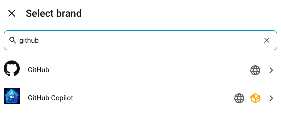
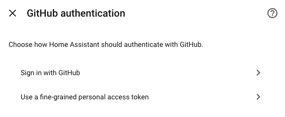
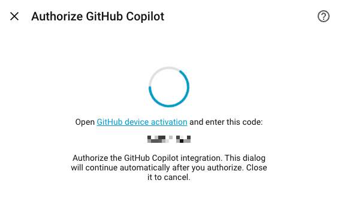
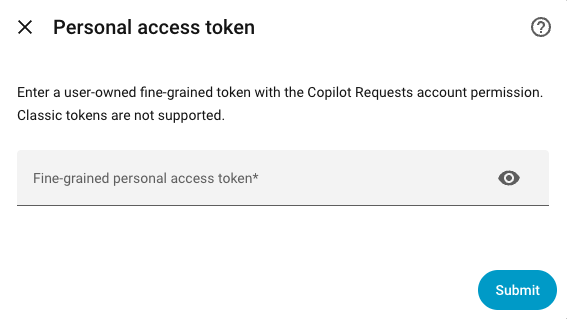
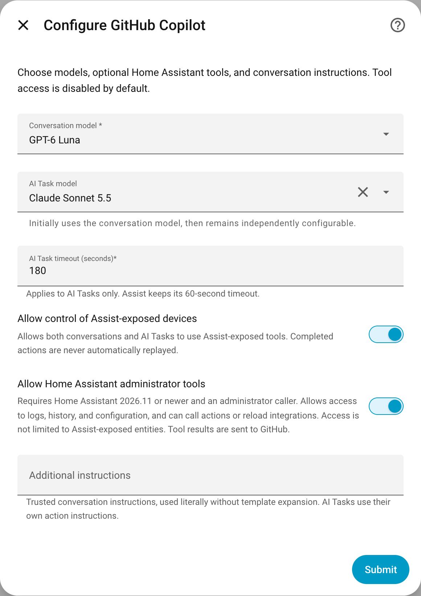
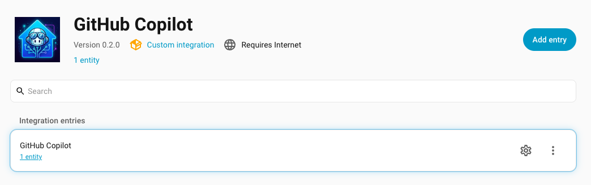
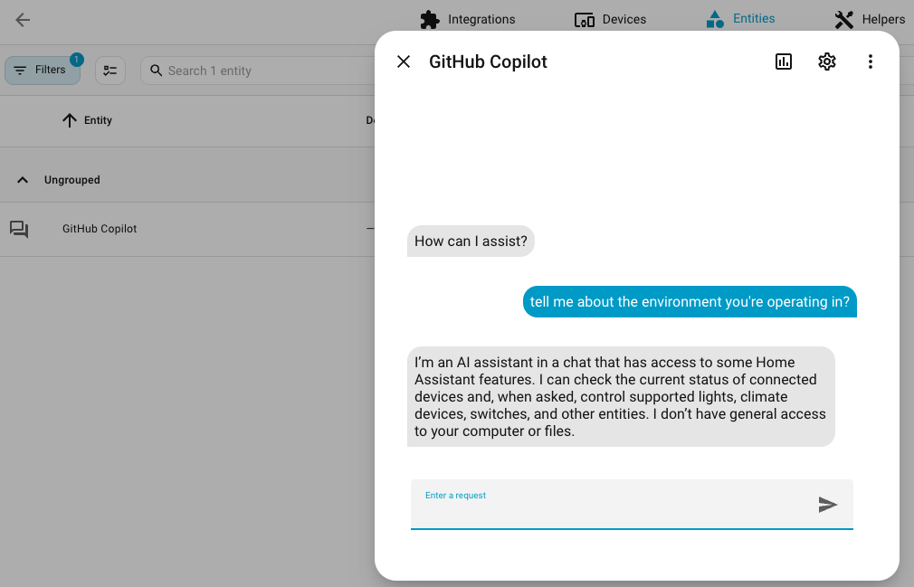
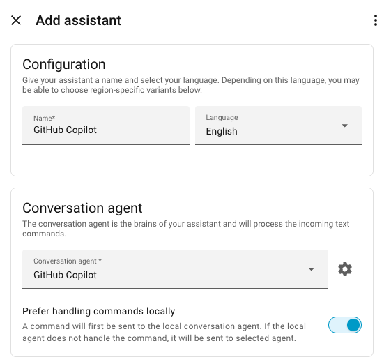

# Set up GitHub Copilot for Home Assistant

This guide walks you through installing the integration, connecting your GitHub
account, and testing a conversation. You can also configure GitHub Copilot as the
conversation agent for a Home Assistant voice assistant.

## Before you begin

You need:

- Home Assistant 2026.10.0 or newer on a supported 64-bit Linux runtime
  (ARM64 or x86-64), with outbound access to GitHub.
- A GitHub account with Copilot access. Your plan's usage limits, model
  availability, and organization policies still apply.
- Home Assistant Marketplace on 2026.11 or newer, or
  [HACS](https://www.hacs.xyz/docs/use/download/download/) installed separately
  on 2026.10.

GitHub Copilot processes conversations and AI Tasks in the cloud. Prompts,
attached images, relevant device information, and tool results are sent to GitHub
Copilot. See
[conversation data and privacy](usage.md#conversation-data-and-privacy) for
details.

## 1. Install the integration

**GitHub Copilot** is included in the default catalog; no custom repository is
needed.

1. Open **Settings > Marketplace** on Home Assistant 2026.11 or newer, or HACS
   on 2026.10.
2. Search for **GitHub Copilot** and open its listing.
3. Select **Install** in Marketplace, or **Download** in HACS, and confirm.

Alternatively, use this button to open the repository directly, then confirm
the installation:

The button works with both HACS and Marketplace. Home Assistant's
[Marketplace migration guide](https://next.home-assistant.io/integrations/marketplace/#coming-from-hacs)
confirms that existing HACS buttons open the repository in Marketplace.

**Restart Home Assistant before continuing**, if you installed through HACS or if instructed to.

For manual installation instead, see the
[README](../README.md#installation).

## 2. Add GitHub Copilot

1. In Home Assistant, go to **Settings > Devices & services > Integrations**.
2. Select **+ Add integration**.
3. In the **Select brand** dialog, search for `GitHub Copilot`.
4. Select **GitHub Copilot**, not the separate **GitHub** integration.

Home Assistant opens the integration's setup flow and asks how you want to
authenticate. Choose one of the following methods.

## 3. Connect your GitHub account

In the **GitHub authentication** dialog, choose **Sign in with GitHub** for
device activation (recommended), or **Use a fine-grained personal access token**.

### GitHub device activation (recommended)

1. Choose **Sign in with GitHub**.
2. In the **Authorize GitHub Copilot** dialog, open the **GitHub device
   activation** link. Leave the Home Assistant dialog open.
3. Sign in to the GitHub account that has Copilot access, enter the code shown
   in Home Assistant, and authorize the integration.
4. Return to Home Assistant. The dialog continues automatically after
   authorization.

Use the code from your own dialog. If the code expires, start sign-in again.
Closing the Home Assistant dialog cancels authorization.

### Fine-grained personal access token (PAT)

Use this option if you prefer to supply a token instead of using device
activation.

1. In GitHub, [create a fine-grained personal access token](https://github.com/settings/personal-access-tokens/new)
   owned by your personal account with Copilot access.
2. Grant the **Copilot Requests** account permission.
3. In Home Assistant, choose **Use a fine-grained personal access token**.
4. Paste the token into **Fine-grained personal access token** and select
   **Submit**.

**Classic personal access tokens are not supported.** The integration does not
renew PATs automatically; replace the token when it expires or is revoked.
Keep tokens private and out of screenshots, issue reports, and chat messages.

## 4. Choose your conversation and task settings

After authentication, the **Configure GitHub Copilot** dialog lets you choose
how the conversation agent and AI Task entity behave.

The selected models are examples; availability depends on your account. The
screenshot shows device control and administrator tools enabled, but both are
**off by default**. Administrator tools require Home Assistant 2026.11 or newer.

| Setting | What to choose |
| --- | --- |
| **Conversation model** | Select **Auto**, if available, or a specific model from your account's available models. Luna- or Haiku-class models are a good starting point for fast, efficient responses to many Home Assistant requests. |
| **AI Task model** | Optionally choose a different model for automations. Initially defaults to the conversation model, but later changes to the conversation model do not change it. |
| **AI Task timeout (seconds)** | Defaults to 180 seconds. This does not change Assist's 60-second timeout. |
| **Allow control of Assist-exposed devices** | Allows conversations and AI Tasks to use Assist-exposed tools. It is **off by default**. |
| **Allow Home Assistant administrator tools** | On HA 2026.11 or newer, allows administrator-authenticated conversations and data tasks to access logs, history and configuration, and perform actions such as calling services or reloading integrations. Access is not restricted to Assist-exposed entities. It is **off by default**. |
| **Additional instructions** | Instructions for conversations only, such as "Keep replies brief and use Celsius." AI Tasks use the instructions supplied by each action. |

For camera or image analysis, choose an AI Task model with vision support.
Supported image formats and the number of images per request vary by model.
Native image generation uses the account's available image model, not either
of these chat-model selections.

Additional instructions are literal text, not Home Assistant templates. If you
enable device control, review which entities you have exposed to Assist.
Administrator tools can access more than those entities and send their results,
including potentially sensitive logs, to GitHub. The integration does not add an
extra confirmation step before actions.

Select **Submit** to save. When Home Assistant shows **Success**, select
**Finish**.

You can change these settings later under
**Settings > Devices & services > GitHub Copilot > Configure** (the gear icon
beside the integration entry).

An AI Task entity appears alongside the conversation entity without another
sign-in. It normally uses `ai_task.github_copilot`; use the actual entity ID shown
in your installation. See [AI Tasks](usage.md#ai-tasks) for examples.

## 5. Test a conversation

You can test the integration with text before configuring a voice assistant.

1. Under **Settings > Devices & services > Integrations**, open
   **GitHub Copilot**.
2. Select the **entity shortcut** under the integration entry to open its entity
   list.

3. Select the **GitHub Copilot** conversation entity to open its chat dialog.
4. Enter a message, such as "Hello! What can you help me with?", and send it.

A reply confirms that the conversation agent is working. If you enabled device
control, you can also try a request for a device you exposed to Assist, such as
"Turn on the living room light." Use a device name from your own home.
Device access depends on your settings; the example response in the screenshot
does not enable those capabilities.

## 6. Add a voice assistant (optional)

GitHub Copilot supplies the **conversation agent**. It does not provide
speech-to-text or text-to-speech services.

1. Go to **Settings > Voice assistants**.
2. In the **Assist** section, select **+ Add assistant**.
3. Give the assistant a name, such as **GitHub Copilot**, and choose its language.
4. Select **GitHub Copilot** as the **Conversation agent**.
5. Choose the appropriate **Speech-to-text** and **Text-to-speech** options
   from the services configured in your Home Assistant installation, if you
   want voice input and spoken replies.
6. Save the assistant.

The **Prefer handling commands locally** option sends commands to Home
Assistant's local conversation agent first. When enabled, GitHub Copilot handles
requests the local agent cannot handle, so not every command goes to Copilot.
Turn it off if you want requests through this assistant to go directly to
GitHub Copilot.

Language, speech-to-text, and text-to-speech settings belong to Home Assistant
and your chosen speech integrations, not this integration. Select your new
assistant when using Assist, or assign it to your voice device.

## Help and next steps

For tips on which entities to expose, naming devices and areas, and adding
aliases, see Home Assistant's
[best practices with Assist](https://www.home-assistant.io/voice_control/best_practices/).

For AI Tasks, Home Assistant's
[official documentation](https://www.home-assistant.io/integrations/ai_task/)
is the authoritative reference for task behavior and actions. Our
[AI Task usage guide](usage.md#ai-tasks) covers a first task, Copilot-specific
settings and limits, and examples for structured data, camera analysis, and
image generation.

See the [user guide](usage.md) for model fallback, changing settings, updates,
and data handling. If setup, a conversation, or an AI Task fails, start with
[troubleshooting](usage.md#troubleshooting).
